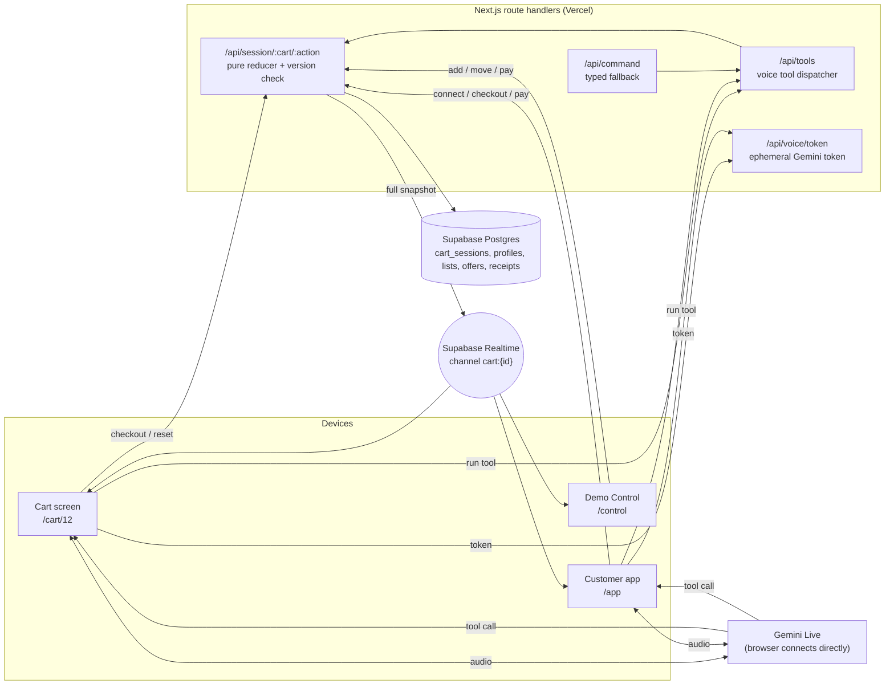

# SiCart

**Hackathon prototype.** A smart shopping cart: no checkout queues, personal offers from purchase
data, in-store navigation, an AI voice assistant, and an accessibility mode for visually impaired shoppers.

Three screens run from one Next.js codebase and stay in sync in real time:

| Surface | Device | What it does |
|---|---|---|
| **Cart screen** `/cart/12` | Tablet or laptop on the cart (landscape) | QR to start, shopper and list, live isometric store map with the shortest route, live cart, recommendations, voice assistant, NFC checkout |
| **Customer app** `/app` | Shopper's phone (installable PWA) | Scan the cart QR, pick a profile, live companion, "hold near the cart to pay", digital receipt; voice-first mode for blind shoppers |
| **Demo Control** `/control` | A second phone (PIN) | Simulates the cart's sensors: drop products in, move the cart, POS tap, scenarios, reset, typed commands |

---

## 1. Purpose

**The problem.** Supermarket checkout queues waste time, paper receipts pile up, personal offers are generic,
finding a product in a large store is slow, and visually impaired people can rarely shop on their own.

**The solution.** The cart itself becomes the checkout and the guide. Products are recognised as they go in
(simulated in this prototype), the total updates live, offers are personal, the screen shows the shortest route
to everything on your list, an assistant understands "I'm cooking carbonara for 4", and you pay by holding your
phone near the cart. For blind shoppers the phone turns into one big talk button with spoken directions.

**What it is not.** No real sensors, payments or authentication: detection and payment are simulated through
Demo Control so the experience can be shown reliably on stage and at the booth.

## 2. A short story (fictional)

Aysel stops at SiCart Market on her way home. She scans the QR on Cart 12 and the screen greets her: "Welcome
back, Aysel", with three offers picked from what she usually buys and her weekly list already loaded. A green
route lights up across the store map.

She puts spaghetti in the cart. It drops onto the screen with a soft *plink*, the total rolls up, the cart on
the map glides to the pasta aisle, and a card suggests the tomato and basil sauce she buys every other week,
20% off for her. She holds the mic: *"I'm cooking carbonara for 4 tonight."* Five ingredients slide into her
list, the route redraws, and the cart answers: *"Added 5 items, about 4 minutes. I picked the cheaper pecorino,
saving you 2 manat 10."*

At the end she presses Checkout, holds her phone near the cart, and the receipt is on her phone. No queue, no
paper.

Murad is blind. He opens SiCart in voice mode and says *"Connect to cart 12."* The cart switches to high contrast,
and his phone guides him: *"Walk 16 meters, then turn left into Aisle 5. Penne is on your right, second shelf."*
Every item he picks up is announced with a short vibration.

## 3. Architecture



- **One source of truth.** Every change runs through a pure reducer on the server (`lib/session/machine.ts`),
  is stored with an optimistic version check, and the **full snapshot** is broadcast on `cart:{id}`. Screens show
  the newest version, ignore older ones and refetch after a reconnect, so they can never drift apart.
- **Voice.** The browser streams microphone audio straight to Gemini Live with a one-use token. When the model
  calls a tool (`plan_recipe`, `find_product`, `find_cheaper`, ...), the browser runs it on `/api/tools`, which
  changes the session like any other action. The model only names ingredients; the server picks the products.
- **Static data in the repo** (`lib/data`): 84 products, store map, recipes, pairings, personas. Only dynamic
  state lives in the database.

## 4. Data

| Static (typed, in `lib/data`) | What it holds |
|---|---|
| `catalog.ts` | 84 products: invented brands, AZN prices, shelf and level, tags, allergens, nutrition, alternatives |
| `storeMap.ts` | 40 × 28 m grid, 12 zones, 22 shelves, 9 aisles, entrance, checkout |
| `recipes.ts` | Carbonara, Greek salad, plov, pancakes + ingredient synonyms |
| `pairings.ts`, `whyLines.ts` | Recommendation graph and pre-written "why" lines |
| `personas.ts` | Aysel (regular shopper) and Murad (accessibility user), store-wide deals |

| Dynamic (Supabase, `supabase/migrations`) | One row is |
|---|---|
| `profiles` | A shopper (persona or guest) |
| `purchase_history` | How often a shopper bought a product |
| `offers` | A personal or store-wide discount |
| `lists`, `list_items` | A shopping list and its items |
| `carts`, `cart_sessions` | A cart and its live session snapshot (status, position, version, state) |
| `receipts` | A paid basket |

Algorithms: A\* on the store grid and a nearest-neighbour + 2-opt route to checkout (`lib/map`), turn-by-turn
directions with few clean turns, a deterministic recommendation scorer (pairing + purchase history + offers), and an
ingredient matcher that always picks the cheapest good product.

## 5. Run it

Requirements: Node 22+ and npm. Secrets live in `.env.local` and are **never committed**; `.env.example` lists
the variable names.

```bash
npm install
cp .env.example .env.local   # then fill in the values
npm run dev                  # http://localhost:3000
```

| Command | What it does |
|---|---|
| `npm run dev` / `npm run build` | Next.js dev server / production build |
| `npm test` | Unit tests (vitest): data integrity, session reducer, route planner, directions, matcher |
| `npm run typecheck` / `npm run lint` | TypeScript and ESLint |
| `npm run seed:gen` / `npm run seed:push` | Rebuild `supabase/seed.sql` from the personas / reset the demo data |
| `npm run db -- db push --remote` | Apply new migrations from `supabase/migrations` |
| `npm run smoke:api -- <url>` | End-to-end check of the session API and Realtime |
| `npm run smoke:voice -- <url> "<what to say>"` | Typed end-to-end check of the voice assistant against Gemini Live |
| `npm run stress -- <url> 30` | Booth stress test: parallel taps must never lose an update |
| `npm run images:codex` | Generate missing product packshots with the Codex CLI (ChatGPT Plus) |

Surfaces: `/` launcher, `/cart/12` cart screen, `/app` customer app, `/app/voice` voice-first mode,
`/control` Demo Control (PIN = `DEMO_CONTROL_PIN`).

The microphone and camera only work on `localhost` or over **HTTPS**, so use the deployed URL on phones.

### Deploy (Vercel)

1. Import the GitHub repo in Vercel (framework preset: Next.js, no other settings needed).
2. Add these Environment Variables (Production and Preview), copied from `.env.local`:
   `NEXT_PUBLIC_SUPABASE_URL`, `NEXT_PUBLIC_SUPABASE_ANON_KEY`, `SUPABASE_SERVICE_ROLE_KEY`, `GEMINI_API_KEY`,
   `DEMO_CONTROL_PIN`, and `NEXT_PUBLIC_APP_URL`.
   `SUPABASE_DB_PASSWORD` and `SUPABASE_PROJECT_REF` are only for the CLI and are not needed on Vercel.
3. Deploy, then set `NEXT_PUBLIC_APP_URL` to the deployed `https://...vercel.app` URL (the cart QR code points
   there) and redeploy.
4. Open the URL on the devices.

## 6. Stage demo (about 4 minutes)

| Time | On stage | Who does what |
|---|---|---|
| 0:00 | Hook: queues, paper receipts, blind shoppers can't shop alone | Presenter |
| 0:20 | Cart idle → scan the QR → pick **Aysel** → "Welcome back, Aysel", 3 personal offers, weekly list, route drawn | Presenter's phone |
| 0:50 | Pasta goes in → plink, fly-in, total rolls, cart glides to aisle 5, sauce recommended −20% (items from her list tick off) | Friend taps *Spaghetti No.5* in Demo Control (solo: long-press "Cart 12" on the phone) |
| 1:20 | **Hero**: hold the mic (or Space) → *"I'm cooking carbonara for 4 tonight"* → 5 items stagger in, route redraws, spoken answer with the pecorino saving | Presenter at the cart |
| 2:00 | *"Where is the olive oil?"* → shelf pulses, route goes there first; *"Find me a cheaper parmesan"* | Presenter |
| 2:30 | Accessibility: second phone on `/app/voice` → *"Connect to cart 12"* → high contrast + spoken turn-by-turn | Friend's phone (or the typed number) |
| 3:10 | Checkout → POS ripple → **hold the phone near the cart** → thank-you on the cart, receipt on the phone | Presenter's phone |
| 3:40 | Close: impact + business model (personal offers from shopping data) in one sentence | Presenter |

Fallbacks: if voice misbehaves, type the same sentence in **Demo Control → Type a command**; if the Control phone
is lost, long-press **"Cart 12"** on the shopper's phone; **Mid-shop** loads a half-full cart; **Reset cart**
returns to the QR screen (it also resets by itself 10 s after payment).

**No real shelves on stage? Demo mode.** The cart screen simulates its own sensors: tap an item in *Your list* (or
**Pick up** on the next-stop card) to drop it in, tap a line in *Your cart* to take it out, or press **Auto-shop** and
the cart walks the route and picks up the whole list by itself. To show the home-list feature, open `/app/list` on the
phone before the QR beat, add a product, then connect: the edited list is what appears on the cart.

## 7. Rehearsal checklist

Before going on stage:

- [ ] `npm run seed:push` (fresh lists and offers), then **Reset cart** in Demo Control.
- [ ] Cart screen open on the deployed URL, full screen, brightness up; **tap it once** so sounds are enabled.
- [ ] Presenter's phone: `/app` open, camera permission granted (scan once to test).
- [ ] Mic permission granted on the cart screen and the phone; the mic button shows **"Hold to talk"** (voice is warm).
- [ ] Demo Control open on the friend's phone with the PIN entered.
- [ ] Second phone for the accessibility beat on `/app/voice`, volume up.
- [ ] Run the whole script **5 times in a row without reloading** any screen.
- [ ] Hall Wi-Fi: if the connection badge says "Reconnecting…", screens keep updating by polling; keep a phone hotspot ready.

At the booth: let judges scan the QR themselves (guest profile works), keep Demo Control in hand, and press
**Reset cart** between visitors.

## 8. Team

| GitHub | Role |
|---|---|
| [@aslanmusayev](https://github.com/aslanmusayev) | _to be filled_ |
| [@RuslanQuliyev06](https://github.com/RuslanQuliyev06) | _to be filled_ |
| [@Sardar094](https://github.com/Sardar094) | _to be filled_ |
| [@orucovasalminaz-prog](https://github.com/orucovasalminaz-prog) | _to be filled_ |

## 9. Contributing

See [CONTRIBUTING.md](CONTRIBUTING.md). Short version: branch from `main`, small commits, open a pull request,
and a teammate approves it before it is merged.

## License

MIT, see [LICENSE](LICENSE).
